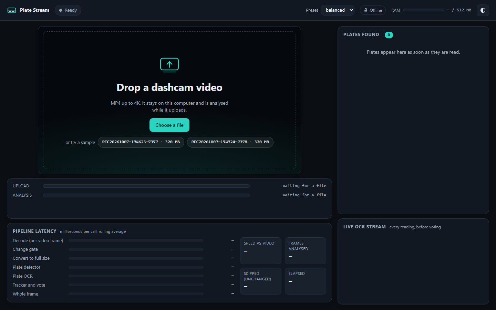
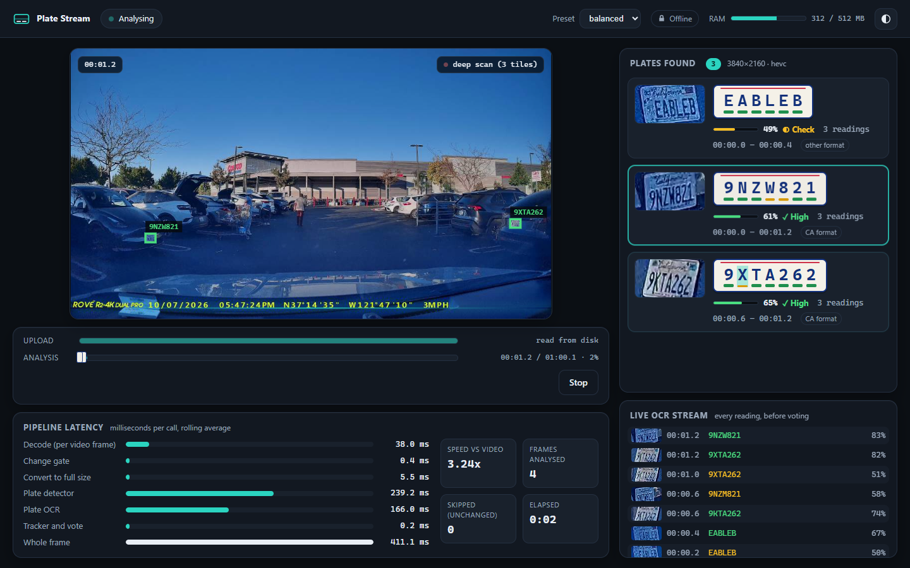
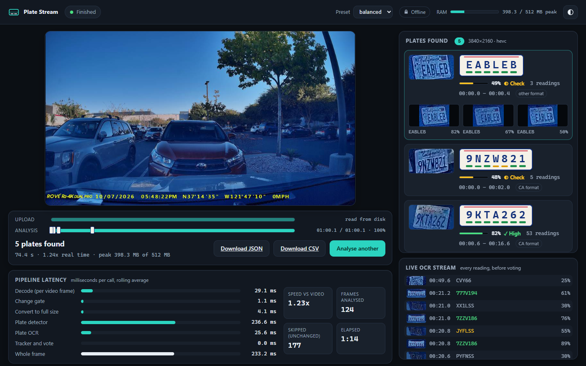
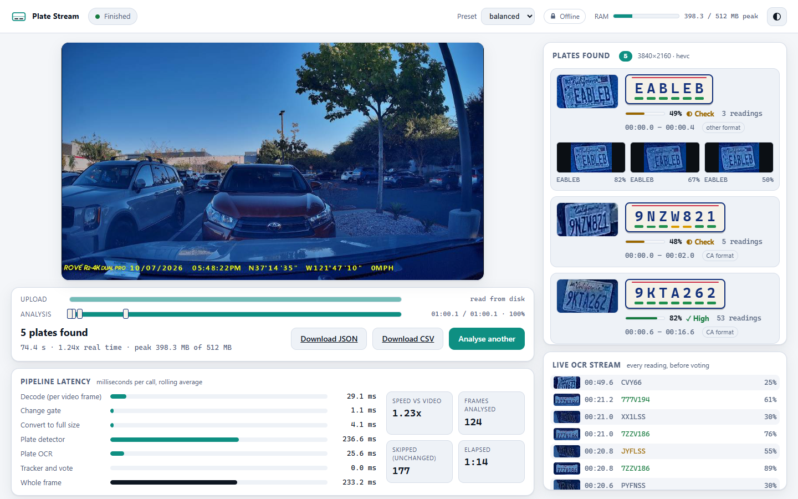
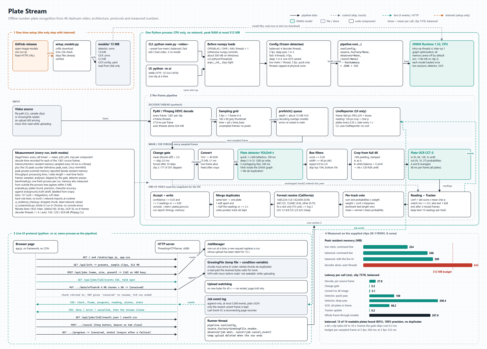

# Offline number plate recognition for dashcam video

Reads a dashcam video and lists every unique vehicle number plate in it. Runs on the CPU,
fully offline, in well under 512 MB of RAM.

```
python main.py REC20261007-174724-7378.mp4
```

```
PLATE       FIRST SEEN  LAST SEEN   CONF   READINGS
9NZW821     00:00.000   00:02.000   0.48   5
EABLEB      00:00.000   00:00.400   0.49   3
9KTA262     00:00.600   00:16.600   0.82   53
9FCF543     00:01.800   00:09.600   0.56   15
7ZZV186     00:10.200   00:21.200   0.69   37
```

## Setup

Python 3.11 or newer (developed on 3.13, Windows 11). Linux works the same way.

```bash
python -m venv .venv
.venv/Scripts/activate            # Linux/macOS: source .venv/bin/activate
pip install -r requirements.txt
python scripts/setup_models.py    # downloads 13 MB of models, once. The only step needing internet
```

After setup the program makes no network calls. Developers also run
`pip install -r requirements-dev.txt` (pytest, ruff, onnx).

## Docker (one command)

```bash
docker compose up --build
```

Then open http://127.0.0.1:8765. The build installs the dependencies and downloads the two
models (checked by SHA-256); after that the container needs no internet. Compose publishes the
port on this computer only, limits the container to 512 MB of memory, mounts this folder
read-only so its videos appear as one-click samples, and keeps results in a named volume.

Without Compose:

```bash
docker build -t plate-stream .
docker run --rm -p 127.0.0.1:8765:8765 --memory 512m -v "$PWD:/videos:ro" plate-stream
```

The command-line tool in the same image:

```bash
docker run --rm --memory 512m -v "$PWD:/videos:ro" plate-stream \
  python main.py /videos/REC20261007-174724-7378.mp4 --out-dir /tmp/out
```

## Run

```bash
python main.py <video> [--preset low-mem|balanced|fast] [--out-dir output]
```

Writes `<out-dir>/<video name>.plates.json` and `.plates.csv`, prints the table above, then
the processing time and peak memory. Every plate has `plate`, `first_seen`, `last_seen`,
`confidence` (0 to 1) and `readings` (frames that contributed). The JSON also has a `run`
section: video facts, settings, model hashes, per-stage times, frame counts, peak memory.

Useful options: `--sample-fps`, `--decode-threads`, `--threads`, `--min-confidence`,
`--debug` (saves every plate crop to `<out-dir>/debug/`), `--max-seconds` (quick test).
`python main.py --help` lists all of them.

| Preset | Decoder threads | Sample rate | Detector | Use |
|---|---|---|---|---|
| `balanced` (default) | 4 | 5 fps | 3-tile pass every 3rd frame | Best accuracy per second |
| `fast` | 4 | 4 fps | 3-tile pass every 4th frame, one OCR variant | Less work per clip |
| `low-mem` | 1 | 3 fps | single pass only | Smallest footprint, slowest decode |

## Results

Measured on the development machine (Intel i9-11950H, 8 cores, 64 GB, Windows 11, Python 3.13)
with `python scripts/benchmark.py`: every preset on both supplied clips, one fresh process
per run. Raw numbers: `output/benchmark/results.json`.

### Accuracy, time and memory

| Clip | Preset | Plates found | Precision | Character accuracy | Wall time | Real-time factor | Peak RAM |
|---|---|---|---|---|---|---|---|
| 7377 | **balanced** | 89% (8 of 9) | 100% | 89% | 77.6 s | 1.28x | 348 MB |
| 7378 | **balanced** | 100% (5 of 5) | 100% | 100% | 60.5 s | 0.99x | 368 MB |
| 7377 | fast | 67% (6 of 9) | 75% | 86% | 56.9 s | 0.93x | 343 MB |
| 7378 | fast | 100% (5 of 5) | 100% | 100% | 53.0 s | 0.87x | 343 MB |
| 7377 | low-mem | 44% (4 of 9) | 100% | 44% | 146.4 s | 2.43x | 257 MB |
| 7378 | low-mem | 80% (4 of 5) | 100% | 79% | 122.4 s | 2.02x | 254 MB |

- **Plates found** is the share of the plates a person can read that came out exactly right.
  **Precision** is the share of reported plates that were right.
- **Character accuracy** counts every character of a missed plate as wrong.
- **Real-time factor** is processing time divided by video length. Below 1.0 is faster than
  real time. Peak RAM is measured twice, inside the program and from outside by a separate
  process; the two agree within 5 MB. The budget is 512 MB.
- Both clips together, `balanced`: 13 of 14 plates found (93%), no false positives.
- The ground truth is a draft (see Known limitations).

### Latency per pipeline component

Time per call in milliseconds, mean and 95th percentile, from the same runs.

| Component | Clip 7377 balanced | Clip 7378 balanced |
|---|---|---|
| Decode, per source frame (30 fps video) | 39.6 / 127.4 | 27.8 / 97.9 |
| Change gate | 0.3 / 0.7 | 0.3 / 0.4 |
| Convert to full-resolution image | 3.4 / 5.4 | 3.1 / 4.3 |
| Detector, single pass | 131.8 / 246.1 | 109.0 / 120.3 |
| Detector, 3-tile pass | 365.1 / 683.7 | 300.4 / 330.2 |
| Crop | 0.0 / 0.1 | 0.2 / 1.1 |
| OCR (all plates in the frame) | 22.6 / 132.1 | 88.2 / 182.4 |
| Tracker update | 0.1 / 0.3 | 0.2 / 0.8 |
| **Whole frame through the models** | **238.7 / 520.9** | **267.6 / 493.8** |

The other presets are in `output/benchmark/results.md`.

### Is it real time? Would it work on a live stream?

- **Today it is a file processor.** It reads the file as fast as it can and finishes a
  60 s clip in about 60 to 78 s with `balanced`, and in 53 to 57 s with `fast`.
- **Decoding keeps up with 30 fps video** (about 28 to 40 ms per frame at 4 threads, so 25 to
  36 frames per second), with little to spare. Each 1 s keyframe costs more, which is the
  95th-percentile figure.
- **The models are the limit.** A frame that goes through detection and OCR takes about
  240 to 270 ms on average, up to 520 ms at the 95th percentile. At 5 sampled frames per
  second the budget is 200 ms, so a live feed would fall slowly behind. At 3 frames per second
  (333 ms) the average fits. `low-mem` samples at 3 frames per second but its single thread
  makes each frame slower, so it does not keep up.
- **Frames the change gate skips cost 0.3 ms**, so a parked car or an empty road is nearly free.
- **A plate appears in the results about one second after it is first seen**, because it is
  confirmed once several readings agree. A live deployment would show it as soon as it passes
  the acceptance filter.
- **Streaming is not measured.** These figures come from file runs. A live camera would add
  network or capture delay that is not included here.

## Live web UI

```bash
python -m ui          # opens http://127.0.0.1:8765
```

Drop a video (or press a sample clip). The file is uploaded in 4 MB chunks, and analysis starts
**while it is still arriving**. The page shows, in parallel:

- the frame being analysed, with plate boxes and labels (the server sends the frames the models
  actually saw, so it works for HEVC clips that a browser cannot play)
- **Plates found**: each plate as a plate-style chip, with a crop of the real plate beside it,
  a confidence bar with a word (High, Check, Low), per-character confidence underlines, the
  number of readings and the time range. Click a card to see the crops behind it. Characters
  flash when the vote changes them (watch `9XTA262` become `9KTA262`)
- **Live OCR stream**: every individual reading before voting, newest first
- upload and analysis progress with ETA, plate pins on the timeline
- **Pipeline latency** per component, speed against the video clock, frames analysed and
  skipped, and live memory against the 512 MB budget
- Stop at any time; download JSON and CSV when finished

| Idle | Analysing |
|---|---|
|  |  |
| **Finished** | **Light theme, phone** |
|  |  |

How it works: a small standard-library HTTP server (no new dependencies) runs the same
pipeline in a worker thread. A growing-file reader lets the decoder read an MP4 whose index is
at the start (both supplied clips) while it uploads. Results travel to the page as
Server-Sent Events: frames, readings, the current plate list, and statistics. The server keeps
only the newest unsent frame, so a slow browser never builds a backlog.

- **Offline and local:** it binds to 127.0.0.1, the page loads nothing from other sites (a test
  checks this), fonts are the system fonts.
- **Memory:** a whole clip with the UI open peaked at 393 to 399 MB (command line: 348 to 368 MB),
  still under 512 MB. Uploaded files are deleted when a run ends.
- **One clip at a time**, to protect the memory budget. A second request gets a clear "busy" message.
- **Flaky or dead uploads recover.** Each chunk is retried up to five times, resuming from the
  server's own byte count, so a dropped request neither loses nor duplicates data. If the
  upload truly fails, the page says why ("Upload failed at 4%: the connection to the server was
  lost"), tells the server to stop, and the next upload is accepted straight away. An upload
  that goes silent for 45 seconds is ended by the server, and closing or reloading the tab
  frees the server at once. `python scripts/ui_resilience_check.py` breaks the upload on purpose
  in Chrome and checks all three.
- **A file whose index is at the end** (some non-fast-start MP4s, AVI) cannot be decoded while it
  uploads. It simply waits for the full upload, then runs.
- The design process (plan, reasoning, critique, colour psychology, states) is in
  [docs/superpowers/specs/2026-11-14-live-ui-design.md](docs/superpowers/specs/2026-11-14-live-ui-design.md).
  `python scripts/ui_screenshots.py` drives the page in Chrome and regenerates the screenshots.
- Confidence words describe how well the OCR readings agree, not a calibrated probability. The
  number is always shown, and the crops let a person check.

## Architecture



Full-size vector version: [docs/architecture.svg](docs/architecture.svg). It is generated by
`python scripts/draw_architecture.py`, so it can be redrawn when the code changes.

## How it works

```
PyAV decode (own thread) -> change gate -> plate detector -> full-resolution crop
        -> plate OCR -> tracker with per-character voting -> JSON / CSV / console
```

1. **Decode** with PyAV (FFmpeg). Every frame has to be decoded (HEVC P-frames depend on the
   previous frame), but only frames on the 5 fps grid are converted to pixels.
2. **Change gate.** A 160x90 thumbnail is compared with the last processed frame. When the
   scene is unchanged (the car parked behind another for 40 s), detection is skipped.
3. **Detect** plates with a small YOLOv9 model. One 640 px pass covers the whole frame; every
   third frame also runs three overlapping 640 px tiles over a 1280 px version of the frame,
   which finds smaller, more distant plates. Boxes that are too narrow, too wide (badge
   lettering) or in the camera's overlay strip are dropped.
4. **Crop from the original 4K frame**, so the OCR sees full detail even for a 60 px plate.
   Each crop is read twice (as is, and white-balanced with contrast boost) and the two
   probability tables are averaged.
5. **OCR** gives, for each of 10 character slots, a probability for each of 36 characters.
6. **Track and vote.** Readings of the same plate in consecutive frames join one track. Per
   slot, probabilities are added up, weighted by reading quality, and the winning character is
   taken. Tracks with near-identical text (one character apart, close in time) are merged.
7. **Format check.** California formats (`1ABC234`, motorcycle `1A23456`, older `ABC123` and
   `123ABC`) are recognised. If the model is unsure about a slot, the format decides between
   letter and digit. A confident reading is never overruled. Other text (vanity plates,
   out-of-state) is kept with a modest penalty.

## Models

Both are pretrained, ONNX, run with ONNX Runtime. No PyTorch or TensorFlow is ever loaded.

| Role | Model | Size | Source | Licence |
|---|---|---|---|---|
| Plate detector | YOLOv9-t, 640 input, NMS inside the graph | 7.8 MB | [open-image-models](https://github.com/ankandrew/open-image-models) release `yolo-v9-t-640-license-plates-end2end.onnx` | Code MIT. The weights' own licence and training data are not stated by the author |
| Plate OCR | fast-plate-ocr `cct-s-v2-global-model`, 64x128 input | 5.3 MB | [cnn-ocr-lp](https://github.com/ankandrew/cnn-ocr-lp) release `arg-plates` | MIT. Its region list includes the United States |

SHA-256 values are in `scripts/setup_models.py`, which checks them.

## Decisions backed by measurement

- **Memory is set by the video decoder.** FFmpeg's automatic threading peaked at 624 MB for the
  decoder alone. Each thread adds about 50 MB on top of about 250 MB, so decoder threads are
  capped at 4.
- **ONNX Runtime's memory arena is off.** With it on, clip 2 peaked at 517 MB (over budget),
  with it off 371 MB, for roughly 15% more time. `--arena` turns it on.
- **numpy is told to use one BLAS thread before it loads.** On a 16-thread Windows machine it
  otherwise commits about 500 MB at import.
- **Decoding runs in its own thread.** Decoding is the slowest stage, and it now overlaps with
  detection.
- **Frames are shrunk to 1280 px for tiling, not 1920 px.** 8 tiles per frame took about 750 ms.
  3 tiles every third frame finds the same plates in these clips.
- **No text rule for badge lettering.** `EABLEB` is a real all-letter vanity plate in both
  clips; the lettering on a Chevrolet or Ford tailgate is rejected by its shape instead.

## Known limitations

- **A plate visible for about a second is easy to miss.** `9VCA051` (a car turning out of view
  at the start of clip 1) gets one weak reading and is dropped.
- **Distant plates are not read.** Below about 60 px wide the OCR output is mostly wrong, and
  those readings are filtered out. That matches the brief (only plates a person can read).
- **Similar characters.** E/F and X/Y are confused on blurry plates. `9FCF543` in clip 2 is
  probably `9ECF543`; the evaluation accepts both.
- **All-letter vanity plates** are kept but score lower than standard plates.
- **Only California formats are built in.** Other US states work as plain text with the
  fallback weight. Another country needs its templates added to `anpr/plate_format.py`.
- **Weights licence.** The author of the detector weights does not state their licence or
  training data. Check before commercial use.
- **The ground truth is a draft.** I labelled it from enlarged crops. A person has not checked
  it against the video, and clip 2's raw output was seen before the confidence thresholds
  were set, so clip 2 is not a clean held-out test.
- **Timings are noisy on a shared machine.** Another process on the development machine was
  using about a third of the CPU during some runs.

## Project layout

```
main.py                   command-line entry point
anpr/                     the package (video, gate, detector, crop, ocr, plate_format,
                          tracker, metrics, output, pipeline, config)
scripts/setup_models.py   one-time model download
scripts/evaluate.py       compare a result with eval/ground_truth/
scripts/benchmark.py      all presets on all clips -> output/benchmark/results.md
eval/ground_truth/        plates present in each clip (draft)
ui/                       optional live web UI (python -m ui): server, jobs, static page
tests/                    pytest, 137 tests; integration tests skip without models
output/                   sample results for the supplied clips
docs/superpowers/         design (specs/) and implementation plan (plans/)
```

Tests: `pytest -q` (about 15 s). Lint: `ruff check .`.
