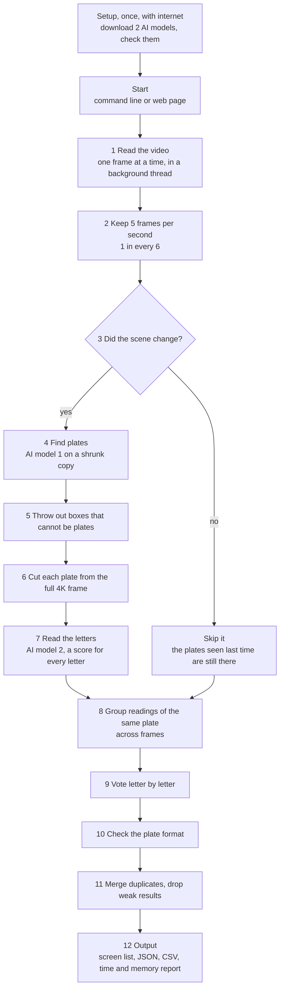
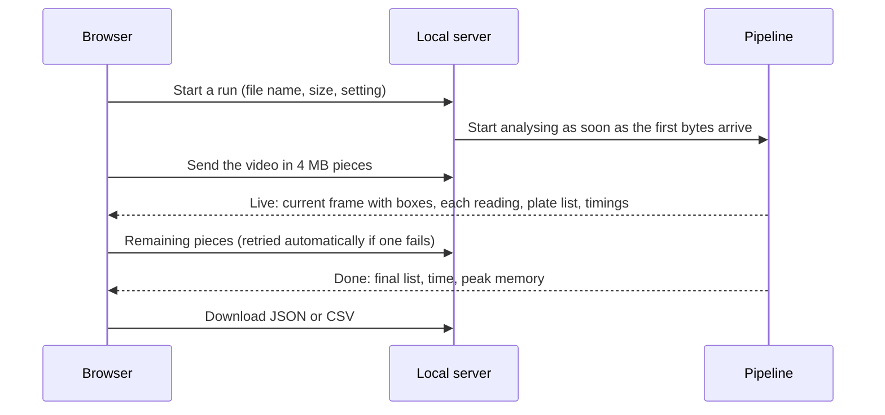

# Plate Stream: how it works and why it is built this way

This document explains, in plain English:

1. how the system works from start to finish,
2. which overall designs were considered, and why the chosen one won,
3. every important decision, the options that were rejected, and why.

All numbers were measured on the two supplied 4K dashcam clips on the development machine
(Intel i9-11950H, 8 cores, Windows 11). Full results are in the [README](../README.md).

---

## 1. The job

Read a 4K dashcam video and list every unique vehicle number plate in it, with the time it was
first and last seen and a confidence score. Rules from the brief:

- run **fully offline** (no internet while running),
- use **at most 512 MB of memory**,
- run on a **normal CPU** (no graphics card needed),
- list **each plate once**, even though it appears in many frames.

The supplied videos: 60 seconds each, 3840 x 2160, 30 frames per second, H.265 (HEVC), about
320 MB each, with **California** plates (the brief assumed Indian plates; the video showed
otherwise).

---

## 2. End-to-end flow

### 2.1 The picture

### 2.2 Step by step

**Before first use (needs internet once).** `scripts/setup_models.py` downloads the two AI
models (13 MB in total) and checks each file's fingerprint (SHA-256) so a damaged or altered
file is refused. With Docker this happens while the image is built. After this, nothing uses
the internet.

**1. Read the video.** The video library (PyAV, built on FFmpeg) opens the file and decodes it
frame by frame in a background thread. Only one full-size frame is in memory at a time. Every
frame must be decoded, because each H.265 frame is stored as a change from the frame before it.
Cost: about 28 to 40 ms per frame.

**2. Keep 5 frames per second.** A plate does not change in 1/30 of a second, so only every
sixth frame goes on. For each kept frame a tiny grey thumbnail (160 x 90) is made.

**3. Skip unchanged scenes.** The thumbnail is compared with the last analysed frame. If almost
nothing changed (a parked car, a red light), the frame is skipped and the plates already being
followed simply stay visible. Cost: 0.3 ms. In clip 2 this skipped 177 of 301 frames.

**4. Find plates (AI model 1, the detector).** The frame is shrunk and the detector draws boxes
around anything that looks like a plate.
- Normally: one quick pass over the whole frame (about 110 ms). It finds plates about 80 pixels
  wide and larger.
- Every third analysed frame: a deeper pass over three overlapping tiles of a 1280-pixel-wide
  copy (about 300 ms). It finds smaller, more distant plates.

**5. Throw out impossible boxes.** Simple rules reject boxes that are too small to read, the
wrong shape (wide car-badge lettering such as "CHEVROLET"), in the sky, or on the camera's
date-and-speed overlay at the bottom.

**6. Cut the plate from the full 4K frame.** The box is mapped back to the original 4K frame and
cut out with a small margin. Two versions are prepared: as is, and colour-corrected with boosted
contrast (the footage has a strong blue tint).

**7. Read the letters (AI model 2, the reader).** The reader looks at each plate image and, for
each of up to 10 letter positions, gives a probability for every possible character. Both
versions are read and their scores averaged. Cost: about 25 to 90 ms per frame, depending on how
many plates are in view.

**8. Group readings of the same plate.** The tracker links a reading to the plate it saw in the
previous frames, by box overlap, or by almost-identical text nearby. A plate that has not been
seen for 3 analysed frames is closed.

**9. Vote letter by letter.** For each plate, the letter scores from all its readings are added
up, giving more weight to sharp, confident readings. The winning letter in each position forms
the answer. One misread frame (`9KTA282`) is outvoted by many good ones (`9KTA262`).

**10. Check the format.** California plates follow patterns such as `1ABC234` (car), `1A23456`
(motorcycle), `ABC123` and `123ABC` (older). If the reader is unsure in one position (0 or O?),
the pattern decides. If the reader is confident, the pattern never overrules it, so personalised
plates such as `EABLEB` survive.

**11. Merge duplicates and drop weak results.** Plates with the same text, or one letter apart
and seen close together in time, are merged into one. A plate is reported only if its confidence
is at least 0.35 and it was read in at least 2 frames (or once with confidence 0.65 or more).

**12. Output.** A list on screen, a JSON file and a CSV file. The JSON also holds a run report:
time per step, peak memory, frames analysed and skipped.

### 2.3 The live web page (optional)

- The server runs on the same computer (127.0.0.1) and is part of the same program.
- Analysis starts **while the video is still uploading**: in a test, analysis began when only
  168 of 320 MB had arrived.
- The page shows the frame being analysed with plate boxes, a card for each plate with the
  actual plate photo next to the text, every raw reading as it happens, and live timings and
  memory.
- If the upload breaks, pieces are retried and resume where they stopped. If the browser
  closes or the upload goes silent for 45 seconds, the run is ended so the next one can start.

---

## 3. Overall designs considered

### Chosen: two small AI models + tracking + voting

Small detector finds plates on a shrunk frame, small reader reads them from the full 4K frame,
and many readings per plate are combined by voting.

**Why:** both models together are 13 MB and run on a normal CPU through a lightweight runtime.
Reading from the full 4K frame keeps letters sharp. Voting across frames turns several noisy
readings into one reliable answer. Measured result: 13 of 14 readable plates, no false plates,
no duplicates, under 400 MB.

### Rejected: classical image processing only (no AI)

Find plates with edge detection, shape rules or Haar cascades (an older pattern-matching
technique), then read with a general OCR.

**Why not:** published comparisons show these methods break down on moving dashcam footage with
glare, angles and text-like objects (grilles, signs, badges). The only ready-made US plate
cascade belongs to OpenALPR, which carries the AGPL licence. Accuracy would have been far below
the chosen design.

### Rejected: classical pre-filter, then AI only on candidate areas

Use cheap edge detection to suggest areas, and run the AI detector only there.

**Why not now:** it adds tuning risk (a missed area means a missed plate) to save work that is
already affordable. Detection is not the slowest part once decoding runs in parallel. Kept as a
future option if detection ever becomes the bottleneck.

### Rejected: find vehicles first, then plates inside each vehicle

A car detector first, then a plate detector inside each car box.

**Why not:** it needs a third model (more memory and time), and a missed car means a missed
plate. Tiling already makes small plates large enough for the plate detector directly.

### Rejected: one large general AI model or a cloud service

A large vision-language model, or a cloud OCR API.

**Why not:** large models need gigabytes of memory, far over 512 MB. Cloud services need the
internet, which the brief forbids, and send customer footage off the machine.

### Rejected: analyse every frame

All 30 frames per second through the AI.

**Why not:** about 7 times slower. Five frames per second plus voting already finds the plates a
person can read.

### Rejected: analyse keyframes only

Decode only the "full" frames the video stores once per second, which is about 30 times cheaper
to decode.

**Why not:** one frame per second is too few. A plate passing quickly would be seen once or
not at all, and voting needs several readings.

---

## 4. Decisions, one by one

### 4.1 Programming language

| Chosen | Rejected | Why |
|---|---|---|
| Python | C++, Rust | All the needed video and AI libraries have good Python versions, and the heavy work runs in compiled code underneath. Faster to build and easier to read for a one-minute-video tool |

### 4.2 Reading the video

| Chosen | Rejected | Why |
|---|---|---|
| **PyAV** (FFmpeg) | OpenCV video reader | OpenCV's common setting for decoder threads does not actually control them (checked in its source), and it always converts frames to full colour. PyAV gives direct thread control and a cheap grey thumbnail |
| | FFmpeg as a separate process | Works, but adds a second process and piping; PyAV does the same inside one process |
| | Hardware (graphics) decoding | Not available on every machine; benefit to memory unclear. Left as a possible extra |

### 4.3 Decoder threads

| Chosen | Rejected | Why |
|---|---|---|
| **4 threads** | Automatic (16 here) | Measured: automatic threading alone used **624 MB**, over budget |
| | 1 thread | 138 MB but 3 times slower (130 s per clip). Kept as the `low-mem` setting |

### 4.4 Decoding in a background thread

| Chosen | Rejected | Why |
|---|---|---|
| Decode in a background thread while the AI works | Decode and analyse in turn | Decoding is the slowest single part (about 44 s per clip). Overlapping it with the AI cut total time roughly in half |

### 4.5 How many frames to analyse

| Chosen | Rejected | Why |
|---|---|---|
| **5 per second** + skip unchanged scenes | All 30 per second | About 7 times slower |
| | Keyframes only (1 per second) | Too few readings per plate |

### 4.6 Running the AI models

| Chosen | Rejected | Why |
|---|---|---|
| **ONNX Runtime** on CPU | PyTorch | PyTorch alone can use several hundred MB of memory |
| | TensorFlow | Same problem, and the chosen models are not in that format |
| | OpenVINO | Intel-specific; ONNX Runtime runs everywhere and was enough |

ONNX Runtime's memory pool ("arena") is **turned off** by default: with it on, clip 2 peaked at
517 MB (over budget) for about 15% more speed. It can be switched on with `--arena`.

### 4.7 The plate detector

| Chosen | Rejected | Why |
|---|---|---|
| **YOLOv9-tiny plate detector** from open-image-models (7.8 MB) | Ultralytics YOLOv8 / YOLO11 plate models | **AGPL licence**: would force the whole product to be open source. Also need PyTorch to convert |
| | NVIDIA LPDNet (US plates) | Strong on US plates, but NVIDIA licence terms, download needs NVIDIA's tools, built for their GPU stack. Kept as a comparison option |
| | OpenVINO plate detector | Trained on Chinese plates only |
| | Haar cascades | Weak on angled, moving footage (see section 3) |

Note: the detector's code is MIT-licensed, but its author does not state the licence of the
trained weights. Check before commercial use.

### 4.8 How the detector looks at a frame

| Chosen | Rejected | Why |
|---|---|---|
| Quick single pass on every analysed frame, plus a **3-tile deep pass on every third** | Shrink the whole 4K frame to 640 px only | Plates become 10 to 30 px wide; small ones are missed |
| | 8 tiles of a 1920-px copy on every frame | Found the same plates in these clips but cost about 750 ms per frame |

The top 15% (sky) and bottom 5% (camera overlay) of the frame are ignored.

### 4.9 Where to read the plate from

| Chosen | Rejected | Why |
|---|---|---|
| Cut the plate from the **full 4K frame** | Read it from the shrunk copy | On the shrunk copy a plate is about 15 px wide and unreadable; in 4K it is 60 to 180 px |

### 4.10 The plate reader (OCR)

| Chosen | Rejected | Why |
|---|---|---|
| **fast-plate-ocr CCT-S** (5.3 MB) | NVIDIA LPRNet (US) | Good on California plates but 55 MB, NVIDIA licence, built for their GPU stack |
| | PaddleOCR / RapidOCR | General text readers: they also read the red "California" word, stickers and frames |
| | Tesseract | Fails on real plate photos unless they are perfectly cropped |
| | EasyOCR | Needs PyTorch (too much memory) |
| | PARSeq, TrOCR | Too large (about 95 MB and more) and PyTorch-based |

Deciding factor: CCT-S was trained on plates (including US), and it gives a **probability for
every letter**, which is what makes letter-by-letter voting possible.

### 4.11 Two versions of each crop

| Chosen | Rejected | Why |
|---|---|---|
| Read the crop as is **and** colour-corrected, average the scores | One version only | The footage has a strong blue tint; neither version is best on every plate. Averaging is cheap (the reader is fast). The `fast` setting reads one version to save time |

### 4.12 Combining readings into one answer

| Chosen | Rejected | Why |
|---|---|---|
| **Add up letter probabilities** across readings, weighted by confidence and sharpness | Majority vote on whole strings | Throws away how sure the reader was about each letter |
| | Take the single most confident reading | One misread frame can win |

### 4.13 Fixing text with plate formats

| Chosen | Rejected | Why |
|---|---|---|
| Apply the format **only where the reader is unsure**; look-alike pairs (0/O, 1/I, 8/B, 5/S, 2/Z, 6/G) are easier to swap | Always force text into the standard format | Tried first: it turned a correctly read motorcycle plate (`8D94661`) into a wrong car plate (`8DSA661`) |
| Added the **motorcycle** format | Standard car format only | Clip 1 contains a motorcycle plate |
| Reject car-badge lettering by **box shape** | Reject any all-letter text | `EABLEB` is a genuine personalised plate; a text rule would have deleted it |

### 4.14 Duplicates and the final filter

| Chosen | Rejected | Why |
|---|---|---|
| Merge plates one letter apart **if seen within 2 seconds** or if one has far fewer readings | Merge only identical text | One plate was split into four slightly different versions |
| | Merge anything one letter apart | Could merge two different cars |
| Report if confidence ≥ 0.35 and (≥ 2 readings or confidence ≥ 0.65) | 0.5 confidence | Dropped readable plates. The value was chosen from clip 1's results |

### 4.15 Faster model versions (8-bit)

| Chosen | Rejected | Why |
|---|---|---|
| **Not built** | 8-bit (INT8) detector | Tested about 2 times faster on a sample model, but detection is no longer the slowest part, and it needs accuracy re-checking. Kept as a future option |

### 4.16 Measuring

| Chosen | Rejected | Why |
|---|---|---|
| Time every call of every step; sample memory every 50 ms **and** read the operating system's peak counter; benchmark in a fresh process; also measure from outside | Report one overall time | The brief requires proven memory and time; per-step timing shows where time goes |
| Hand-labelled list of correct plates per clip | No accuracy measure | Accuracy was a judging criterion. The list is still a draft until a person checks it |

### 4.17 The live web page

| Chosen | Rejected | Why |
|---|---|---|
| **Python's built-in web server** | FastAPI, Flask | Extra installs and memory for a single-user local page |
| **Server-Sent Events** for live updates | WebSockets | Updates only flow one way; SSE is built into browsers and reconnects on its own |
| Server sends the **frames it analysed** as small pictures | Play the uploaded video in the browser | Many browsers cannot play H.265, and playback would drift from the analysis |
| **Plain HTML, CSS, JavaScript** | React or another framework | Works offline, no build step, nothing loaded from the internet |
| **Analyse while uploading** | Upload first, then analyse | The brief asked for streaming with results shown in parallel |
| **One run at a time** | Several runs in parallel | Two runs would break the 512 MB budget |
| Upload in **4 MB pieces** with retry and resume | One single upload | A single failure would lose the whole upload |

Lesson from testing: one real upload stopped halfway and left the server busy. Since then,
silent uploads end after 45 seconds, a closed tab frees the server, and pieces can be resent
safely. This is checked by breaking the network on purpose in Chrome.

### 4.18 Packaging

| Chosen | Rejected | Why |
|---|---|---|
| **Docker + Compose**, models downloaded during the build | Manual setup only | One command on any machine; the container needs no internet afterwards |
| Memory limit of 512 MB in Compose | No limit | Enforces the budget. Not yet tested here, because Docker Desktop would not start on this machine |

---

## 5. Where it stands

**Measured (balanced setting):** 13 of 14 readable plates found across both clips (93%), no
false plates, no duplicates; 60 to 78 seconds per 60-second clip; peak memory 348 to 368 MB
(399 MB with the web page) against 512 MB.

**Known limits:**

- A plate visible for about a second can be missed (one car turning out of view was).
- Distant or blurry plates are not read.
- Look-alike letters (E/F, X/Y) can be confused on blurry plates.
- Only California formats are built in; other regions need their patterns added.
- Not yet fast enough for a live camera at 5 frames per second.
- The correct-plate lists are drafts until a person checks them against the videos.

**Suggested next step for missed short sightings:** analyse more frames only when a plate is
in view, and read a plate's predicted position between full detections (cheap, about 5 to 10 ms
per plate).
